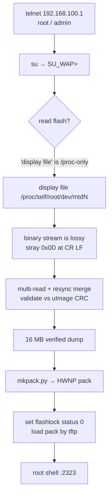
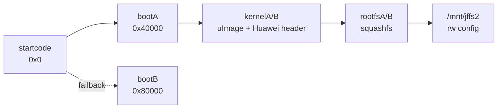

# Hacking the Huawei HG8010H (GPON ONT)

Notes from a two-evening session on owned hardware. Read-only first, then a
verified full dump, then a root shell. No JTAG, no clip, no soldering.

## Device

| | |
|---|---|
| Model | Huawei EchoLife **HG8010H** (GPON ONT) |
| SoC | HiSilicon **SD5115S** — ARMv7 Cortex-A9, single core |
| RAM | 128 MB DDR (118 MB usable) |
| Flash | 16 MB SPI NOR, **Spansion S25FL128S** (`JEDEC 01 20 18`) |
| Boot chain | `HuaWei StartCode 2012.02` → `U-Boot 2010.03` → Linux 3.10.53-HULK2 |
| Rootfs | squashfs 4.0, xz, 256 KiB blocks, read-only |
| Config | `hw_ctree.xml` on a rw JFFS2 partition |
| Default creds | `root/admin`, `telecomadmin/admintelecom` |

## The whole path



## Flash layout

```
0x000000  startcode   256K   first stage, selects bootA/bootB
0x040000  bootA       256K   U-Boot  ┐ A/B pair, byte-identical
0x080000  bootB       256K   U-Boot  ┘
0x0C0000  flashcfg    256K
0x100000  slave_param 256K   boot counter / active bank (written at runtime)
0x140000  kernelA     2M     ┐
0x340000  kernelB     2M     ┘ uImage, header CRC + data CRC
0x540000  rootfsA     4.5M   ┐
0x9C0000  rootfsB     4.5M   ┘ squashfs + Huawei wrapper
0xE40000  file_system 1.5M   JFFS2, rw
0xFC0000  reserved    256K
```



## Enabling telnet (stock firmware)

Telnet is compiled in and `X_HW_CLITelnetAccess Access="1"` is already set — it
is only blocked by the LAN ACL. Fix that in the config file:

1. Browse to `http://192.168.100.1` and log in as `telecomadmin` / `admintelecom`
   (or `root` / `admin`).
2. **System Tools → Configuration File → Download** → save `hw_ctree.xml`
   (menu wording varies slightly between firmware revisions).
3. In that XML, change exactly one attribute:

   ```diff
   - <AclServices HTTPLanEnable="1" ... TELNETLanEnable="0" TELNETWanEnable="0" .../>
   + <AclServices HTTPLanEnable="1" ... TELNETLanEnable="1" TELNETWanEnable="0" .../>
   ```

   Leave `TELNETWanEnable="0"` — LAN only.
4. **System Tools → Configuration File → Upload** the edited file. The ONT
   reboots itself; power-cycle if it does not.
5. Port 23 is open:

   ```console
   $ telnet 192.168.100.1
   Login: root              # or root/adminHW, telecomadmin/admintelecom
   Password: admin
   WAP>su
   success!
   SU_WAP>
   ```

Keep the unmodified `hw_ctree.xml` — it is the rollback. Uploading a config
replaces the running one, so change nothing else in the file.

A hidden page at `/html/ssmp/telnet.asp` toggles the same ACL; the config route
above is the one verified on this unit.

The config file itself is not included here: it contains the device serial,
MAC addresses and per-user password hashes. Keep your own copy out of version
control.

## Getting in

```sh
telnet 192.168.100.1
# Login: root / Password: admin
su                       # WAP> → SU_WAP>
```

`SU_WAP>` has ~220 commands. The useful ones:

```sh
display ?                     # list everything
display file /proc/mtd        # flash map
display file /proc/self/root/dev/mtd0   # ← the bypass: raw flash bytes
set flashlock status 0        # unlock SPI writes (reverts each boot)
```

**Why the bypass matters:** `display file` only accepts paths starting with
`/proc`. `/dev/mtd1` is rejected, `/proc/../dev/mtd1` is rejected, but
`/proc/self/root/dev/mtd1` is not. That one string is the whole read primitive.

Reading is not byte-exact though: the CLI runs the output through a text-mode
line discipline that inserts a stray `0x0D` before `0x0A` non-deterministically.
Fix: take 4–8 paced reads, decode `CRLF → LF`, resync-merge pairs, and keep the
result whose uImage CRCs validate.

## Writing: the HWNP pack

Firmware updates use a container, not a raw image:

```
0x00  "HWNP"
0x04  fileLength      big-endian, = (header + extra + items + payload) - 0x4C
0x08  fileCrc         crc32(header[0x0C:] + extra + items + data)
0x0C  headerSize
0x10  headerCrc       crc32(header[0x14:] + extra + items)
0x14  itemCount
0x1C  item stride     0x168
0x20  product ids     256 B, e.g. "2B2|...;COMMON|"
...   items: crc32 | offset | size | name[256] | type[80] | …
```

No signature — CRC32 only. That is why a hand-built pack is accepted:

```sh
set flashlock status 0
load pack by tftp svrip 192.168.100.10 remotefile shell-pack.pack
display progress load
# → "Software Operation Successful!RetCode=0x0"
```

Building a rootfs image: Huawei header (`whwh` + version, type, uImage length,
crc32) → uImage header → squashfs. Two traps:

1. **Repack the squashfs as root**, or the 66 `/dev` device nodes are lost.
2. The uImage header CRC covers the *data-CRC field*, so write the data CRC
   before computing the header CRC.

## Root shell

`shell` mode in the CLI is a real shell that simply gets stdin at EOF, so
`getcustominfo.sh → exec /bin/sh -i` returns immediately. busybox has no
`telnetd`, `nc` or `httpd` either.

Solution: a 68 KB static ARM binary (`shellsvc`) started from
`/etc/rc.d/rc.start/1.sdk_init.sh`. It listens on **2323**, allocates a pty
(`/dev/ptmx` + `TIOCSPTLCK`/`TIOCGPTN`/`TIOCSCTTY`), and relays socket ↔ pty.

```sh
telnet 192.168.100.1 2323      # root shell
```

Three details that were each a bug first:

| Symptom | Cause | Fix |
|---|---|---|
| `ls` → `: not found` | no tty, `ls\r` never split | allocate a pty |
| `q` in `top` needs Enter | not the foreground pgrp → `tcsetattr` gets `SIGTTOU` | `setpgid(0,0)` + `TIOCSPGRP` |
| `Ctrl-C` ignored | init starts us with `&`, so `SIGINT` is `SIG_IGN` and survives `exec` | reset to `SIG_DFL` in the child |

## Gotchas

- **Serial is RX-only.** Boot logs come out, keystrokes never go in. A U-Boot
  prompt would be blind, so leave the bootloader alone.
- **Never write `startcode`, `bootA` or `bootB`.** No JTAG, no U-Boot prompt.
  The A/B pair may save you; it is unproven.
- `root=/dev/mtdblockN` changes after each update — the banks rotate.
- Everything outside `/mnt/jffs2` and flash is lost on reboot.
- Before any write: keep a CRC-verified full dump. That is the only rollback.

## Files

| Path | Contents |
|---|---|---|
| `bootlog/` | `kernel-boot.log` — full UART capture, StartCode → U-Boot → kernel → userspace |
| `SHELL-SESSION.md` | annotated transcript: stock CLI, then the patched root shell |
| `firmware/` | **`shell-pack.pack`** — the final build (root shell on :2323); see [FIRMWARE.md](FIRMWARE.md) |
| `tools/` | `shellsvc` (root shell, port 2323), `flashpull` (full dump over TCP), `mkpack.py` (HWNP packer), `tftpd.py`; sources + `Makefile` that rebuilds both binaries byte-identically |
| `../dumps/` | `fresh-dump/full.bin` — verified 16 MB image |
| `../packs/` | built HWNP packages |
| `../refs/` | reference firmware used to derive the container format |
